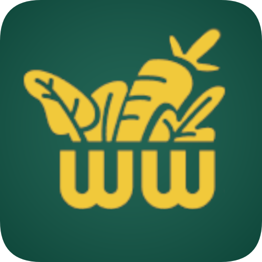

# 🌱 GrowWise Frontend (`GW-front`)

<p align="center">
  
</p>

<p align="center">
  <b>Smart Agriculture & IoT Soil Telemetry Monitoring Application</b>
</p>

<p align="center">
  <a href="https://flutter.dev/"></a>
  <a href="https://dart.dev/"></a>
  <a href="https://developer.android.com/"></a>
  <a href="https://github.com/cucuradu/GW-back"></a>
</p>

---

## 📖 Overview

**GrowWise** is a modern, cross-platform mobile and web application built with Flutter. It connects agronomists, farmers, and indoor plant growers with real-time IoT hardware deployed in soil beds. 

The application monitors soil macronutrients (**Nitrogen, Phosphorus, Potassium - NPK**), soil moisture, ambient temperature, and humidity. It pairs raw sensor telemetry with agronomic thresholds and machine learning models to deliver actionable advice, watering schedules, and automated PDF/CSV reports.

---

## 🌟 Key Features

| Feature | Description |
| :--- | :--- |
| 📊 **Real-Time Telemetry** | Live gauges and cards for soil moisture, temperature, and NPK macronutrients. |
| 🧠 **Smart Recommendations** | Automated condition assessments comparing sensor readings against crop requirements (Tomatoes, Cucumbers, Carrots, Potatoes). |
| 📈 **Interactive Charts** | Smooth, historical telemetry visualization powered by `fl_chart`. |
| 💧 **Irrigation & Watering** | Track soil saturation states and schedule optimal irrigation intervals. |
| 🤖 **ML Crop Predictions** | Integrated prediction service for yield potential and growth trajectory. |
| 📄 **Data Export & Sharing** | Generate and export professional **PDF crop dossiers** and **CSV datasets** via native device sharing. |
| 🗺 **Geospatial Mapping** | Google Maps integration to visualize sensor coordinates across crop fields. |
| 🌓 **Adaptive Theming** | Fully responsive dark and light modes powered by Provider and SharedPreferences. |
| 📳 **Refined UX** | Pull-to-refresh, skeleton shimmer loaders, and tactile haptic feedback (`flutter_vibrate`). |

---

## 🏗 Architecture & Repository Structure

```text
GW-front/
├── assets/                  # Branding, icons, vectors, and illustration assets
├── lib/
│   ├── Theme/               # Dynamic Material design theming
│   │   ├── theme.dart       # Light and dark color palettes
│   │   └── theme_provider.dart # Persistent theme state management
│   ├── services/            # Background & platform integrations
│   │   ├── export_service.dart       # PDF & CSV report compiler
│   │   ├── ml_prediction_service.dart # Growth & yield inference
│   │   └── weather_service.dart      # Real-time ambient weather integration
│   ├── utils/               # Helpers (animation, haptics, platform detection)
│   ├── widgets/             # Reusable UI component library
│   │   ├── interactive_chart.dart
│   │   ├── modern_sensor_card.dart
│   │   ├── sensor_history_chart.dart
│   │   ├── skeleton_loader.dart
│   │   └── smart_recommendation_card.dart
│   ├── analysis_page.dart   # Deep-dive analytics & telemetry trends
│   ├── config.dart          # Backend REST API endpoint configuration
│   ├── homepage.dart        # Main dashboard & telemetry summary
│   ├── login.dart           # User login with JWT authentication
│   ├── main.dart            # Flutter application entry point
│   ├── newsensor.dart       # Add/register new IoT sensor hardware
│   ├── page_selection.dart  # Bottom navigation with Google Nav Bar
│   ├── profilepage.dart     # User profile & account management
│   ├── recomendationspage.dart # Agronomic recommendation cards
│   ├── register.dart        # User account registration
│   ├── sensordetails.dart   # Comprehensive sensor telemetry view
│   ├── sensorspage.dart     # Grid/list of monitored IoT devices
│   ├── test_map_page.dart   # Sensor GPS mapping
│   └── watering_page.dart   # Irrigation & soil saturation management
├── pubspec.yaml             # Flutter dependencies & asset declarations
└── build.sh                 # Cloud build script for Flutter Web
```

---

## 🔗 Backend Connectivity

GrowWise Frontend interfaces with the [GW-back](https://github.com/cucuradu/GW-back) Django REST API.

To configure the API endpoint, update `lib/config.dart`:

```dart
class Config {
  // Local development:
  // static const String baseUrl = 'http://10.0.2.2:8000'; // Android Emulator
  // static const String baseUrl = 'http://localhost:8000'; // iOS Simulator / Web

  // Production deployment (Render):
  static const String baseUrl = 'https://growwise-backend.onrender.com';
}
```

---

## 🚀 Getting Started

### Prerequisites

- [Flutter SDK](https://docs.flutter.dev/get-started/install) (`>= 3.0.5 < 4.0.0`)
- [Dart SDK](https://dart.dev/get-dart)
- Android Studio / Xcode (for mobile emulation) or Google Chrome (for web testing)
- [GW-back](https://github.com/cucuradu/GW-back) backend running locally or deployed

### Installation

1. **Clone the repository**:
   ```bash
   git clone https://github.com/cucuradu/GW-front.git
   cd GW-front
   ```

2. **Install Flutter dependencies**:
   ```bash
   flutter pub get
   ```

3. **Verify Flutter setup**:
   ```bash
   flutter doctor
   ```

---

## 📱 Running the Application

### Mobile (Android / iOS)
Connect a physical device or start an emulator, then run:
```bash
# Debug mode
flutter run

# Run on a specific device
flutter run -d <device_id>
```

### Web
Launch locally in Google Chrome:
```bash
flutter run -d chrome
```

---

## 📦 Building for Production

### Android APK / App Bundle
```bash
# Build universal APK
flutter build apk --release

# Build Google Play App Bundle (AAB)
flutter build appbundle --release
```

### iOS (macOS required)
```bash
flutter build ipa --release
```

### Web (Render / Netlify / Firebase Hosting)
You can use the included `build.sh` script or run:
```bash
flutter build web --release
```
The compiled static assets will be output to `build/web/`.

---

## 🛠 Dependencies & Libraries

- **State & Routing**: `provider`, `shared_preferences`, `page_transition`
- **UI Components**: `google_nav_bar`, `shimmer`, `pull_to_refresh`
- **Charts & Telemetry**: `fl_chart`
- **Maps & Location**: `google_maps_flutter`, `location`
- **Exporting**: `pdf`, `csv`, `share_plus`
- **Hardware Integrations**: `flutter_vibrate`

---

## 👥 Contributing

1. Fork the Project
2. Create your Feature Branch (`git checkout -b feature/NewFeature`)
3. Commit your Changes (`git commit -m 'feat: Add NewFeature'`)
4. Push to the Branch (`git push origin feature/NewFeature`)
5. Open a Pull Request
